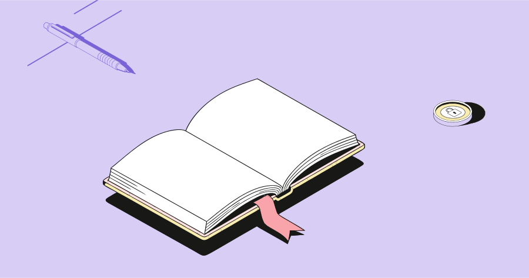
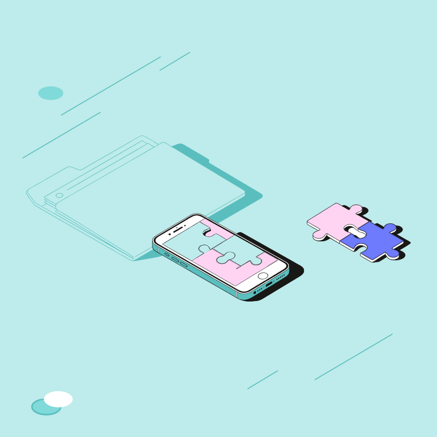
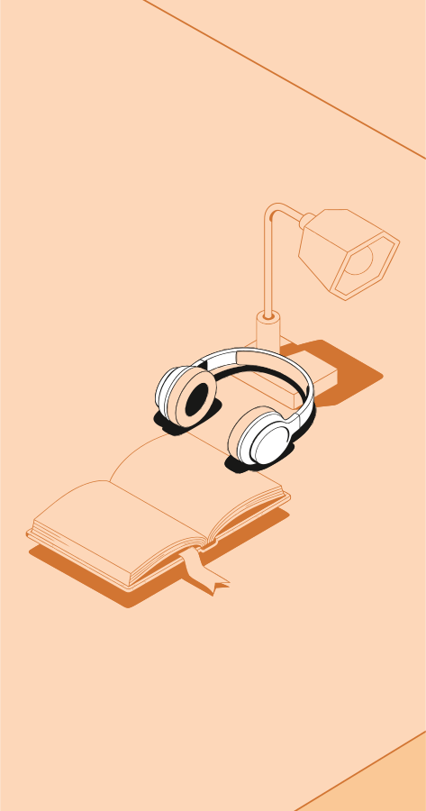

# Короткая демонстрация

После запуска откройте http://127.0.0.1:8000. Проверка занимает около двух минут.

1. Нажмите **«Инвестиции в знания»** над холстом — готовая композиция откроется без ключа.
2. Выберите книгу, переместите её, поверните. Дублируйте предмет и измените слой.
3. Переключите горизонтальный формат на вертикальный и L на S: экземпляры и роли сохранятся.
4. Нажмите **«Отменить»**, затем **«Повторить»**.
5. Загрузите `examples/palette.json`: изменятся цвета, но не исходные контуры.
6. Сохраните JSON-проект, очистите холст и откройте сохранённый файл.
7. Скачайте SVG. Это самостоятельный векторный файл с отдельными группами.
8. Для второго сценария выберите «Из выбранных предметов» и введите `Телефон, пазлы, папка`.
9. Если настроен Groq: выберите **«По идее · ИИ»**, введите «Инвестиции в знания»
   или «Работа в команде» и нажмите сборку. Под холстом появится объяснение выбора.

Готовые примеры ниже воспроизводимы командой `python scripts/build_examples.py`.
Они созданы правилами компоновки с явно заданными предметами и ролями, а не выдаются
за новый ответ модели. PNG здесь — только иллюстрации документации; результат сервиса — SVG.

## Инвестиции в знания

Книга и монета — основные, ручка — фоновая. Горизонтальный формат, L.

[SVG](../examples/learning.svg) · [Редактируемый проект](../examples/learning.json)

## Командная работа

Телефон и пазлы — основные, папка — фоновая. Квадрат, L.

[SVG](../examples/teamwork.svg) · [Редактируемый проект](../examples/teamwork.json)

## В фокусе

Наушники — основной объект, лампа и книга — фоновые. Вертикальный формат, S.

[SVG](../examples/focus.svg) · [Редактируемый проект](../examples/focus.json)
