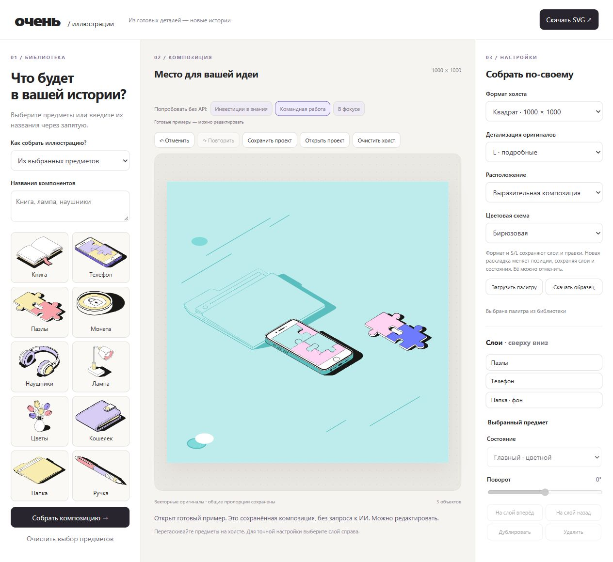

# Проверки перед сдачей

Дата: 13 ноября 2026. Основная проверенная среда — Windows, Python 3.12.

## Автоматические проверки

`python -m unittest discover -s tests -v` — **14 тестов успешно**:

- SHA-256 оригинальных SVG и сохранность path-геометрии после экспорта/перекраски.
- Уникальность SVG-id при дублировании и отсутствие raster image.
- Раскладки для 1–10 предметов, L/S, трёх форматов в пределах холста.
- Сохранение ролей, поворотов, дубликатов при адаптации/перераскладке.
- Цветовые роли фоновых и основных предметов, отклонение некорректной палитры.
- Отклонение неизвестных id и неверного ответа модели, кеш, отсутствие вызова API без ключа.
- Воспроизводимость трёх примеров, повторное редактирование без изменения контуров.

HTTP-проверка: `python scripts/smoke_test.py http://127.0.0.1:8000`.
Она проверяет страницу, каталог, три примера, сборку по названиям, адаптацию,
предпросмотр, импорт сцены, палитру, экспорт и отклонение неизвестного объекта.
Запросов к модели в ней нет.

## Чистая установка

Создана отдельная копия исходников без `.env`, `.venv`, инструментов видео и кэшей.
В ней заново создано окружение Python и установлены зависимости строго из
`requirements-lock.txt`. Все 14 тестов прошли, сервер запущен на другом порту.
Проверено, что API-ключ не настроен, а ручной редактор и готовые примеры работают.

## Проверка интерфейса

В браузере проверены сборка, фоновые состояния, дублирование/удаление, порядок
слоёв, отмена/повтор, смена формата/S/L, автосохранение после перезагрузки,
загрузка пользовательской палитры, скачивание JSON и SVG. Скачанный JSON повторно
прочитан и отрисован сервером с сохранением параметров. На финальной чистой копии
отдельно проверены готовый пример, дублирование и смена раскладки; ошибок JS
в журнале браузера не обнаружено.

## Проверка модели и экспорта

Реальный запрос к Groq «Инвестиции в знания» успешно выбрал книгу, монету и ручку.
Автоматические тесты API не расходуют квоту, вместо сети используют тестовый ответ.

Три финальных SVG отрисованы независимым рендерером Sharp/libvips и визуально
просмотрены. Векторная структура проверена XML-парсером и повторным экспортом.
**Отдельный импорт в Figma в этой сессии не выполнен.** Не заявляется проверка
всех векторных редакторов. В репозитории есть SVG для независимой проверки.

## Что не проверялось / ограничения

- macOS/Linux не запускались локально; workflow для Linux добавлен, но его результат
  в GitHub Actions в момент оформления не подтверждён.
- Нагрузочное тестирование, публичное размещение и многопользовательская работа
  не входят в локальную демонстрацию.
- GitHub без авторизации показывает 404: для закрытого репозитория нужен доступ
  проверяющему либо передача подготовленного ZIP.
